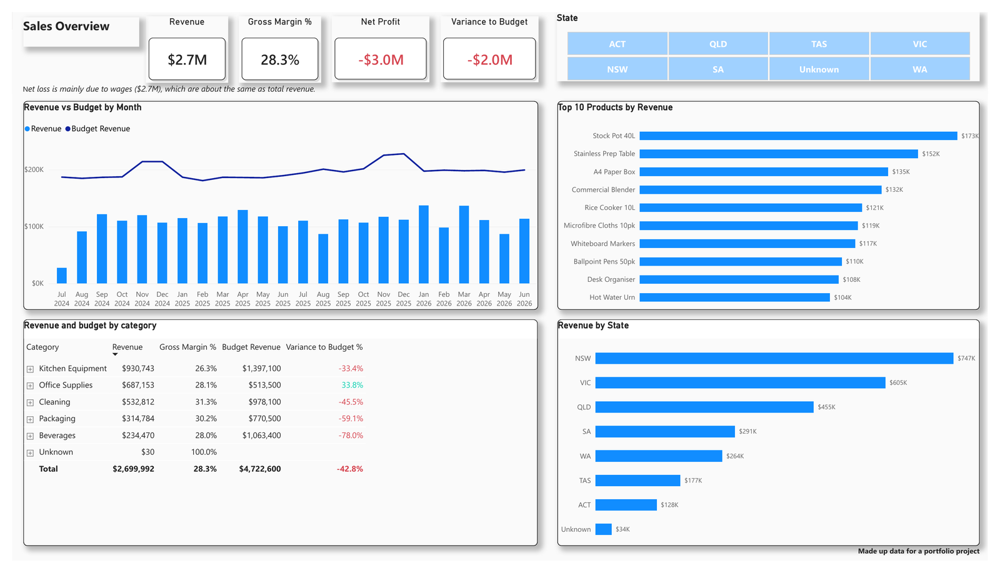
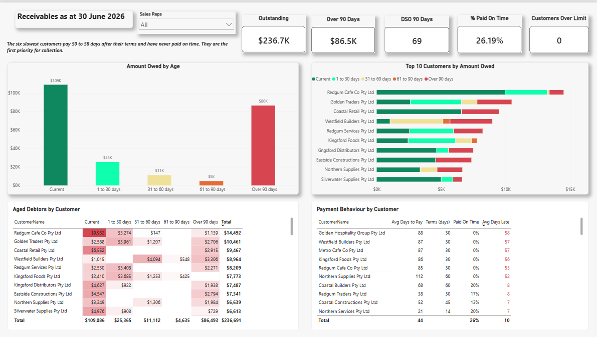

# Harbour Wholesale: Sales and Receivables Report in Power BI

## Overview

This is a Power BI report for Harbour Wholesale, a sample Australian wholesale business that sells beverages, cleaning products, kitchen equipment, office supplies and packaging to businesses across Australia.

The goal was to answer the questions a manager would ask: How are sales tracking? Are we on budget? Who owes us money, and how old is that debt?

The report has two pages:

- **Sales Overview:** revenue, gross margin, net profit and budget, by month, category, product and state.
- **Receivables as at 30 June 2026:** money owed, ageing, top customers owing, and how customers pay.

> All data in this project is made up. Harbour Wholesale is not a real business.
>
> © 2026 Jehan Vijay. All rights reserved. You are welcome to view this work. Please do not copy, reuse or republish it without my permission.

## Screenshots

### Sales Overview

### Receivables as at 30 June 2026

## Files in this repository

- `Harbour_Wholesale.pdf`: a PDF copy of the report pages
- `images/`: screenshots used in this README

The Power BI report file (.pbix) and the source data are not included in this repo. I am happy to share them or walk through the report in an interview. Please contact me through GitHub or LinkedIn.

## Data

One Excel workbook with 8 tables: Customers, Products, Invoices, InvoiceLines, Payments, Budget, Accounts and Expenses. The data covers July 2024 to June 2026.

## Tools

Power BI Desktop, Power Query (M), DAX and Excel.

## Data cleaning (Power Query)

- Set the correct data type on every column.
- Trimmed and uppercased all ID columns (CustomerID, ProductID, InvoiceID, PaymentID) so keys match across tables.
- Found duplicate InvoiceIDs and removed them, keeping one row per invoice.
- Replaced blank State values with "Unknown" so they show clearly in the report.
- Found a sales line with ProductID P099, which is not in the Products table. I added it as an "Unknown product" so the sale is still counted, and flagged it for checking.
- Merged CustomerID and InvoiceDate from Invoices into InvoiceLines, so the sales table links directly to customers and dates.
- Set CustomerID as the key of the Customers table after checking it was unique.

## Data model

I built a star schema:

- **Fact tables:** InvoiceLines (sales), Invoices, Payments, Budget and Expenses.
- **Dimension tables:** Customers, Products, Category, Accounts and a Date table.
- The **Date table** was created in DAX, with Month Year, Month Start and Financial Year (July to June) columns, and marked as a date table.
- A **Category table** was built from the product categories, so Budget (set by category) and sales (by product) can be compared in one visual.
- The Date to Payments relationship is inactive, and is turned on only where needed with USERELATIONSHIP, to avoid two paths between tables.
- All measures are kept in a separate _Measures table.

## Key measures (DAX)

- **Sales:** Revenue, Cost of Goods Sold, Gross Profit, Gross Margin %, Number of Invoices, Average Invoice Value, Units Sold, Revenue Financial Year to Date.
- **Budget:** Budget Revenue, Variance to Budget ($ and %).
- **Profit:** Total Expenses and Net Profit.
- **Receivables:** Outstanding as at 30 June 2026, Over 90 Days, Days Sales Outstanding (DSO), Average Days to Pay, Average Days Late, % Paid On Time, Customers Over Credit Limit.
- **Ageing:** calculated columns on Invoices for amount paid and balance at 30 June 2026, days overdue, and ageing bucket (Current, 1 to 30, 31 to 60, 61 to 90, Over 90 days).

Budget and expense measures only show when no state is selected, because budget and expenses are not recorded by state. This avoids showing a misleading number.

## Key findings

**Sales and profit**

- Revenue was $2.7M over two years with a healthy gross margin of 28.3%.
- The business made a net loss of about $3.0M. Wages ($2.7M) are about the same as total revenue and make up 73% of all operating expenses.
- Revenue was 42.8% below budget ($2.7M against $4.7M).
- Office Supplies is the only category ahead of budget (+33.8%). Beverages is furthest behind (-78.0%), which suggests its budget may have been set too high.
- NSW and VIC are the largest states by revenue.

**Receivables (as at 30 June 2026)**

- Customers owed $236.7K, and $86.5K of that (over a third) was more than 90 days old.
- Only 26% of payments were made on time, and customers paid on average 10 days after their terms.
- DSO was 69 days, against payment terms of mostly 14 to 45 days.
- Customers who did pay took about 44 days on average, but DSO was much higher (69 days). This shows the main problem is old debts that are not being paid at all, not just slow payers.
- The six slowest customers pay 52 to 58 days after their terms and have never paid on time. They are the first priority for collection.

## Data quality checks

- Checked that every payment matched an invoice (all did).
- Checked the large wages figure against the source data: 72 unique journal entries, three departments each month, no duplicates. The number is real.
- Compared report totals with the source data before trusting them.
- Checked average days to pay in SQL Server against the Power BI measure. Both gave 43.9 days, and no invoice was paid in more than one payment, so the figure is the same per payment and per invoice.

## What I learned

- Build sales measures on the most detailed table (InvoiceLines), so they work with every filter.
- Check that a number makes sense before showing it, and go back to the source data when it looks wrong.
- Some data can only be shown at certain levels. Budget is set by month and category, so it should not be split by customer or state.
- Avoid CALCULATE in calculated columns, as it can cause circular dependency errors.

## Copyright

© 2026 Jehan Vijay. All rights reserved.

This repo is shared so people can see my work. No licence is given to copy, change, reuse or republish any part of it, including the report design, the data, the PDF and the images.
